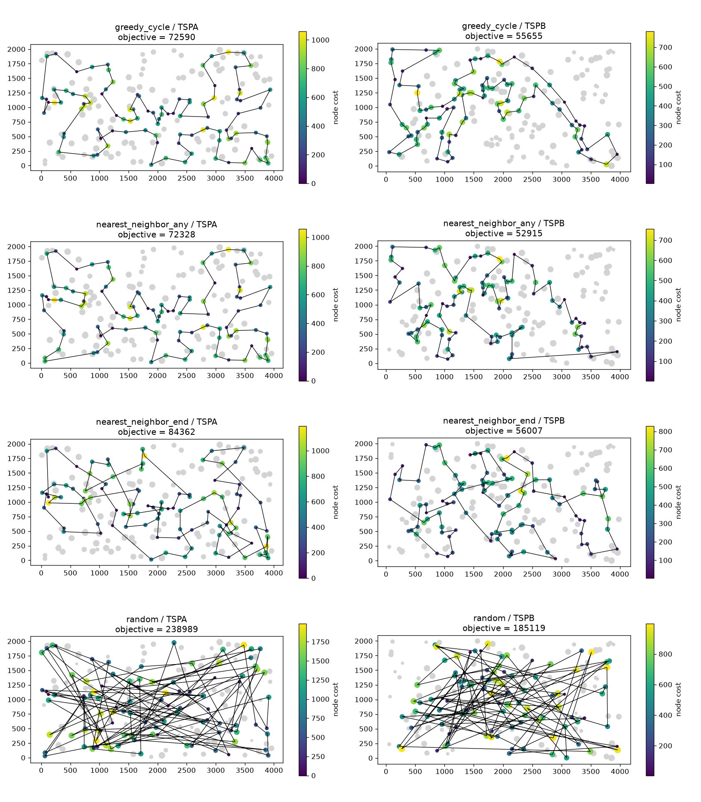

# Assignment 1: Greedy heuristics

Team:

- Adam Mazur 160297
- Jakub Jęsiek 160312

## Problem description

We are given three columns of integers with a row for each node. The first two columns contain x and y coordinates of the node positions in a plane. The third column contains node costs. The goal is to select exactly 50% of the nodes (if the number of nodes is odd we round the number of nodes to be selected up) and form a Hamiltonian cycle (closed path) through this set of nodes such that the sum of the total length of the path plus the total cost of the selected nodes is minimized.

## Implemented algorithms

### Random solution

We pick half of the nodes at random and put them in a random order.

```
RandomSolution(n):
    k = n / 2
    pick k different nodes at random
    return them in random order
```

### Nearest neighbor (add only at the end)

We start from one node. In each step we look at the last node of the path. We add the node that gives the smallest distance from the last node plus its cost.

```
NearestNeighborEnd(start):
    path = [start]
    while path has less than k nodes:
        last = last node of path
        for each node j not in path:
            score(j) = dist(last, j) + cost(j)
        add the node with the smallest score at the end of path
    return path
```

### Nearest neighbor (add at any position)

We start from one node. In each step we try every node that is not in the path yet and every place where we could put it: at the beginning, at the end, or between two nodes in the path. We pick the node and the place that increase the objective the least.

```
NearestNeighborAny(start):
    path = [start]
    while path has less than k nodes:
        for each node j not in path:
            for each position i in path (from 0 to length of path):
                if i is the beginning:
                    delta = dist(j, first) + cost(j)
                if i is the end:
                    delta = dist(last, j) + cost(j)
                if i is between nodes a and b:
                    delta = dist(a, j) + dist(j, b) - dist(a, b) + cost(j)
        insert the node with the smallest delta at its best position
    return path
```

In both nearest neighbor methods we build an open path. At the end we close it into a cycle by connecting the last node with the first one.

### Greedy cycle

We start from one node and add the node that increases the objective the least. With only two nodes the cycle goes to the second node and back, so the edge is counted twice. Then in each step we try every node that is not in the cycle yet and every edge of the cycle where we could put it. We pick the node and the edge that increase the objective the least. Unlike the nearest neighbor methods, we always work on a closed cycle, so there is no beginning or end.

```
GreedyCycle(start):
    for each node j other than start:
        score(j) = 2 * dist(start, j) + cost(j)
    cycle = [start, node with the smallest score]
    while cycle has less than k nodes:
        for each node j not in cycle:
            for each edge (a, b) in cycle (including the edge from last to first):
                delta = dist(a, j) + dist(j, b) - dist(a, b) + cost(j)
        insert the node with the smallest delta into its best edge
    return cycle
```

## Results

Each greedy method was run 200 times on each instance, once from every node. Random solution was generated 200 times. The table shows the objective function value (cycle length plus node costs).

| Method | TSPA min | TSPA max | TSPA mean | TSPB min | TSPB max | TSPB mean |
|---|---|---|---|---|---|---|
| Random | 238989 | 290456 | 262874.39 | 185119 | 225987 | 206009.68 |
| NN (end only) | 84362 | 90075 | 87476.63 | 56007 | 63166 | 59397.34 |
| NN (any position) | 72328 | 77022 | 74346.96 | 52915 | 66164 | 59475.50 |
| Greedy cycle | 72590 | 75345 | 73792.87 | 55655 | 63736 | 59777.50 |

## Visualization

The plots show the best solution for each method and instance. Gray dots are nodes that were not picked. Picked nodes are colored by their cost, and bigger dots mean higher cost.



## Best solutions

### Random

TSPA (238989):

190, 101, 51, 7, 77, 40, 198, 196, 156, 191, 131, 183, 23, 90, 72, 119, 187, 31, 14, 55, 103, 99, 132, 194, 116, 63, 180, 6, 89, 1, 166, 48, 33, 174, 57, 68, 59, 158, 113, 149, 45, 39, 9, 24, 159, 37, 96, 121, 104, 83, 129, 141, 91, 41, 102, 70, 74, 8, 10, 176, 155, 182, 73, 125, 120, 79, 130, 146, 78, 28, 143, 150, 20, 66, 2, 52, 98, 153, 161, 123, 92, 151, 4, 177, 56, 17, 188, 133, 25, 32, 71, 11, 162, 139, 34, 124, 135, 164, 171, 46

TSPB (185119):

148, 152, 128, 95, 61, 29, 193, 118, 69, 106, 140, 112, 177, 160, 26, 8, 77, 85, 34, 147, 72, 135, 86, 21, 142, 40, 133, 92, 175, 11, 139, 84, 88, 51, 178, 98, 60, 57, 22, 74, 32, 64, 70, 186, 53, 30, 121, 157, 156, 96, 107, 19, 110, 82, 90, 155, 3, 97, 168, 101, 33, 130, 174, 188, 185, 166, 138, 50, 195, 189, 49, 115, 16, 108, 109, 27, 12, 183, 54, 59, 184, 191, 120, 52, 80, 199, 39, 179, 159, 162, 151, 111, 154, 119, 35, 150, 17, 198, 7, 143

### NN (end only)

TSPA (84362):

54, 9, 33, 36, 177, 67, 144, 53, 135, 58, 134, 176, 174, 106, 89, 107, 57, 182, 151, 93, 50, 3, 1, 164, 178, 29, 136, 186, 184, 47, 159, 130, 153, 78, 88, 193, 170, 146, 75, 64, 150, 42, 113, 43, 85, 142, 8, 131, 84, 158, 192, 181, 114, 141, 180, 132, 76, 80, 48, 31, 63, 149, 168, 97, 127, 187, 30, 123, 152, 108, 60, 116, 49, 11, 119, 160, 83, 90, 51, 16, 35, 87, 45, 140, 52, 179, 185, 28, 102, 156, 157, 71, 91, 38, 100, 4, 112, 139, 115, 5

TSPB (56007):

32, 89, 57, 76, 54, 127, 129, 90, 153, 20, 14, 2, 110, 118, 56, 114, 196, 10, 148, 143, 78, 192, 162, 104, 185, 184, 3, 151, 69, 172, 133, 120, 96, 121, 198, 48, 72, 46, 86, 117, 160, 136, 8, 21, 154, 140, 47, 170, 125, 177, 6, 132, 29, 197, 175, 134, 45, 60, 40, 71, 155, 97, 115, 180, 65, 28, 149, 145, 158, 116, 147, 42, 50, 130, 30, 183, 38, 64, 85, 59, 167, 51, 87, 179, 82, 88, 171, 99, 67, 24, 34, 181, 152, 73, 98, 27, 135, 75, 79, 156

### NN (any position)

TSPA (72328):

104, 129, 69, 127, 97, 168, 116, 149, 63, 11, 49, 160, 83, 123, 100, 152, 108, 60, 31, 48, 80, 91, 157, 71, 4, 76, 132, 180, 28, 102, 185, 35, 156, 51, 16, 67, 144, 140, 53, 179, 52, 177, 36, 33, 9, 54, 131, 174, 8, 164, 186, 136, 163, 29, 101, 178, 1, 169, 3, 50, 147, 47, 93, 106, 42, 89, 113, 130, 159, 146, 170, 153, 193, 78, 88, 107, 64, 57, 182, 151, 150, 176, 72, 134, 84, 58, 158, 192, 181, 114, 135, 73, 45, 87, 141, 187, 30, 189, 2, 171

TSPB (52915):

110, 2, 14, 20, 74, 153, 182, 52, 90, 129, 127, 80, 54, 192, 162, 104, 76, 185, 57, 89, 86, 46, 72, 3, 184, 173, 151, 122, 117, 8, 160, 69, 172, 136, 133, 120, 156, 43, 48, 96, 198, 121, 130, 191, 50, 42, 147, 116, 37, 146, 13, 149, 28, 145, 65, 158, 177, 125, 26, 170, 197, 36, 132, 29, 6, 180, 115, 155, 71, 175, 134, 45, 157, 60, 40, 141, 97, 154, 140, 47, 38, 21, 176, 30, 183, 189, 168, 64, 59, 85, 51, 73, 167, 152, 34, 24, 181, 179, 87, 82

### Greedy cycle

TSPA (72590):

80, 91, 157, 71, 4, 76, 132, 180, 28, 102, 185, 35, 156, 51, 16, 67, 144, 140, 53, 179, 52, 177, 36, 33, 9, 54, 131, 174, 8, 142, 164, 186, 136, 163, 29, 101, 178, 1, 169, 3, 50, 147, 47, 93, 106, 42, 89, 113, 130, 159, 146, 170, 153, 193, 78, 88, 107, 64, 57, 182, 151, 150, 176, 72, 134, 84, 58, 158, 192, 181, 114, 135, 73, 45, 87, 141, 187, 30, 189, 2, 171, 69, 127, 97, 160, 83, 123, 90, 100, 152, 108, 60, 49, 11, 63, 168, 149, 116, 31, 48

TSPB (55655):

36, 197, 6, 180, 115, 170, 97, 140, 47, 155, 71, 175, 134, 45, 157, 60, 141, 40, 33, 64, 21, 189, 168, 69, 160, 172, 136, 133, 120, 8, 117, 72, 46, 86, 184, 3, 173, 122, 151, 98, 111, 27, 135, 76, 185, 162, 192, 80, 52, 182, 20, 74, 2, 93, 110, 118, 14, 153, 90, 129, 127, 54, 104, 57, 89, 156, 43, 48, 96, 198, 121, 63, 130, 191, 183, 30, 176, 38, 154, 26, 125, 177, 138, 158, 145, 149, 147, 42, 116, 37, 146, 13, 28, 65, 178, 103, 29, 132, 1, 174

## Solution checker

All best solutions were checked: each has 100 distinct nodes and its objective value was recomputed from scratch, independently of the code of the heuristics (the check cell in the notebook). All best solutions were also checked with the provided solution checker (Solution checker.xlsx) and the objective values match.

## Source code

https://github.com/Adam-Mazur/evolutionary-computation-2026

## Conclusions

- All greedy methods are about 3 times better than random.
- NN with any position gave the best single solutions on both instances. It can put a node in the middle of the path, so it avoids the long jumps that NN with end only has to make.
- Greedy cycle has the best mean and the smallest spread on TSPA, but on TSPB its mean is the worst of the greedy methods.
- On TSPB the two NN methods have almost the same mean (NN with any position is even slightly worse on average), so the gain there is only in the best solutions.
