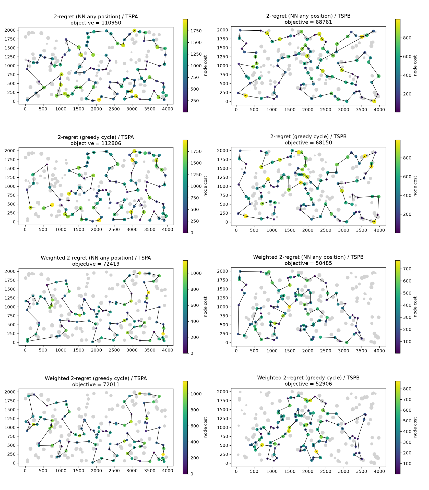

# Assignment 2: Greedy regret heuristics

Team:

- Adam Mazur 160297
- Jakub Jęsiek 160312

## Problem description

We are given three columns of integers with a row for each node. The first two columns contain x and y coordinates of the node positions in a plane. The third column contains node costs. The goal is to select exactly 50% of the nodes (if the number of nodes is odd we round the number of nodes to be selected up) and form a Hamiltonian cycle (closed path) through this set of nodes such that the sum of the total length of the path plus the total cost of the selected nodes is minimized.

## Implemented algorithms

Both new methods are built on top of the two insertion heuristics from assignment 1:

- NN (any position) - we grow an open path. A new node can go before the first node, after the last node, or between two neighbours. The path is closed into a cycle at the end.
- Greedy cycle - we grow a closed cycle (it starts from the start node and the node with the smallest `2 * dist + cost`). A new node can go into any edge of the cycle.

In both cases the insertion cost of node `j` at some position is the change of the objective function, e.g. `dist(a, j) + dist(j, b) - dist(a, b) + cost(j)` for inserting between `a` and `b`.

### Greedy 2-regret

For each node that is not in the solution yet we look at all its insertion positions. The 2-regret of a node is the difference between its second best and its best insertion cost. We pick the node with the largest regret and insert it at its best position.

```
Regret2(start, structure):          # structure = path (NN any) or cycle (greedy cycle)
    solution = initial solution from start (as in NN any / greedy cycle)
    while solution has less than k nodes:
        for each node j not in solution:
            for each position i in solution:
                delta(j, i) = change of the objective after inserting j at i
            best(j)   = smallest delta(j, i)
            second(j) = second smallest delta(j, i)
            regret(j) = second(j) - best(j)
        j* = node with the largest regret (ties: smaller best(j), then lower index)
        insert j* at the position with delta = best(j*)
    return solution
```

### Greedy 2-regret with weighted sum criterion

The same as above, but the node is chosen by a weighted sum of the regret and the best change of the objective function. We use equal weights (`w_regret = w_greedy = 1`).

```
WeightedRegret2(start, structure, w_regret = 1, w_greedy = 1):
    solution = initial solution from start (as in NN any / greedy cycle)
    while solution has less than k nodes:
        for each node j not in solution:
            compute best(j) and regret(j) as in Regret2
            score(j) = w_regret * regret(j) - w_greedy * best(j)
        j* = node with the largest score (ties: smaller best(j), then lower index)
        insert j* at the position with delta = best(j*)
    return solution
```

With `w_regret = 0, w_greedy = 1` this is exactly NN (any position) / greedy cycle from assignment 1, so in the code all of them use one function.

Note on the first step: with a one-node path (or a two-node cycle) all insertion positions give the same solution, so every regret is 0. Because of the tie breaking by `best(j)`, the pure regret version then makes a normal greedy step instead of taking the node with the lowest index.

## Results

Each greedy method was run 200 times on each instance, once from every node. Random solution was generated 200 times. The table shows the objective function value (cycle length plus node costs). The first four rows are the methods from assignment 1, run with the same setup (one run from every node).

| Method | TSPA min | TSPA max | TSPA mean | TSPB min | TSPB max | TSPB mean |
|---|---|---|---|---|---|---|
| Random | 238989 | 290456 | 262874.39 | 185119 | 225987 | 206009.68 |
| NN (end only) | 84362 | 90075 | 87476.63 | 56007 | 63166 | 59397.34 |
| NN (any position) | 72328 | 77022 | 74346.96 | 52915 | 66164 | 59475.50 |
| Greedy cycle | 72590 | 75345 | 73792.87 | 55655 | 63736 | 59777.50 |
| 2-regret (NN any position) | 110950 | 135771 | 121360.29 | 68761 | 79756 | 73649.84 |
| 2-regret (greedy cycle) | 112806 | 128089 | 120378.76 | 68150 | 77274 | 72484.84 |
| Weighted 2-regret (NN any position) | 72419 | 78504 | 75549.36 | **50485** | 61406 | **55698.94** |
| Weighted 2-regret (greedy cycle) | **72011** | 75532 | **73349.74** | 52906 | 63326 | 57766.23 |

Tour length and node cost of the best solutions:

| Method | TSPA length | TSPA cost | TSPB length | TSPB cost |
|---|---|---|---|---|
| NN (any position) | 21816 | 50512 | 20068 | 32847 |
| Greedy cycle | 21570 | 51020 | 19634 | 36021 |
| 2-regret (NN any position) | 21279 | 89671 | 22801 | 45960 |
| 2-regret (greedy cycle) | 21429 | 91377 | 21400 | 46750 |
| Weighted 2-regret (NN any position) | 20127 | 52292 | 18835 | 31650 |
| Weighted 2-regret (greedy cycle) | 20248 | 51763 | 16675 | 36231 |

### Other weights

We also tried other weights of the regret (the weight of the best change of the objective is 1). Mean values over 200 runs:

| w_regret | TSPA NN any | TSPA cycle | TSPB NN any | TSPB cycle |
|---|---|---|---|---|
| 0 (plain greedy) | 74346.96 | 73792.87 | 59475.50 | 59777.50 |
| 0.25 | 74982.28 | 73845.90 | 57085.50 | 56407.76 |
| 0.5 | 75279.73 | **73187.40** | 56150.76 | **55694.02** |
| 1 | 75549.36 | 73349.74 | 55698.94 | 57766.23 |
| 2 | 76408.12 | 74271.08 | **54710.06** | 59713.24 |
| 4 | 79765.55 | 76715.16 | 57077.48 | 57132.58 |

## Visualization

The plots show the best solution for each new method and instance. Gray dots are nodes that were not picked. Picked nodes are colored by their cost, and bigger dots mean higher cost. The plots for the methods from assignment 1 are in the previous report.



## Best solutions

### 2-regret (NN any position)

TSPA (110950):

104, 69, 120, 97, 168, 149, 11, 49, 108, 152, 100, 123, 148, 162, 132, 76, 4, 157, 18, 173, 16, 156, 28, 185, 67, 144, 179, 177, 36, 33, 143, 190, 139, 112, 5, 115, 175, 39, 154, 34, 109, 186, 136, 197, 163, 19, 178, 101, 155, 21, 147, 37, 47, 50, 93, 81, 43, 113, 117, 130, 159, 170, 75, 26, 78, 122, 107, 64, 57, 105, 182, 111, 138, 165, 151, 150, 176, 72, 65, 134, 84, 58, 158, 192, 181, 118, 114, 25, 121, 73, 45, 70, 96, 10, 183, 166, 32, 40, 30, 23

TSPB (68761):

94, 169, 199, 70, 190, 194, 77, 104, 144, 185, 79, 57, 83, 44, 89, 156, 164, 96, 198, 121, 195, 50, 7, 116, 37, 13, 149, 28, 145, 158, 138, 55, 177, 53, 65, 178, 103, 180, 132, 1, 108, 62, 175, 134, 45, 157, 60, 40, 64, 47, 38, 21, 168, 172, 8, 92, 166, 72, 46, 109, 3, 122, 151, 98, 25, 181, 73, 59, 85, 82, 88, 163, 99, 39, 17, 74, 20, 14, 2, 23, 110, 118, 131, 143, 148, 196, 78, 54, 162, 106, 127, 90, 153, 182, 150, 84, 66, 35, 27, 135

### 2-regret (greedy cycle)

TSPA (112806):

125, 120, 188, 168, 11, 82, 80, 160, 30, 141, 191, 180, 28, 156, 185, 67, 190, 51, 196, 4, 18, 139, 112, 5, 115, 175, 39, 154, 34, 62, 143, 33, 9, 194, 174, 81, 85, 142, 164, 184, 195, 136, 197, 163, 19, 29, 17, 55, 86, 46, 6, 147, 37, 47, 50, 93, 117, 130, 159, 170, 75, 26, 78, 88, 107, 64, 57, 124, 89, 106, 151, 165, 182, 111, 192, 20, 65, 72, 134, 84, 99, 36, 177, 179, 53, 140, 41, 61, 121, 181, 118, 114, 25, 22, 70, 10, 183, 166, 189, 187

TSPB (68150):

85, 82, 88, 31, 163, 99, 171, 17, 74, 20, 14, 2, 23, 110, 131, 56, 90, 127, 182, 150, 106, 162, 54, 78, 10, 114, 193, 139, 105, 165, 187, 70, 190, 194, 77, 104, 185, 76, 135, 27, 3, 109, 95, 117, 8, 133, 120, 92, 166, 43, 164, 16, 58, 198, 121, 195, 50, 123, 147, 116, 37, 13, 149, 145, 65, 178, 103, 132, 1, 108, 62, 175, 134, 157, 60, 141, 155, 113, 115, 170, 177, 26, 161, 154, 140, 47, 38, 176, 183, 168, 4, 128, 122, 151, 98, 25, 181, 167, 73, 59

### Weighted 2-regret (NN any position)

TSPA (72419):

171, 2, 189, 187, 30, 141, 87, 45, 73, 135, 114, 181, 192, 158, 58, 84, 134, 72, 176, 174, 150, 106, 113, 89, 42, 151, 138, 182, 57, 64, 107, 88, 78, 193, 153, 75, 170, 146, 159, 130, 47, 93, 50, 3, 169, 1, 59, 178, 101, 55, 29, 163, 136, 186, 164, 142, 8, 9, 54, 33, 131, 36, 177, 52, 179, 53, 140, 144, 67, 16, 51, 35, 185, 102, 28, 180, 132, 76, 4, 71, 157, 91, 80, 100, 123, 83, 160, 152, 108, 49, 60, 116, 149, 63, 168, 97, 127, 69, 129, 104

TSPB (50485):

65, 145, 28, 149, 13, 146, 37, 116, 147, 42, 50, 130, 63, 121, 198, 96, 48, 156, 89, 57, 185, 76, 104, 162, 54, 192, 80, 127, 129, 90, 153, 14, 2, 20, 74, 17, 171, 99, 88, 179, 87, 82, 51, 85, 59, 73, 167, 181, 152, 34, 24, 67, 66, 27, 98, 151, 122, 3, 184, 46, 72, 117, 8, 120, 133, 136, 172, 160, 69, 124, 21, 183, 30, 38, 47, 154, 140, 64, 33, 40, 141, 155, 71, 60, 157, 45, 134, 175, 62, 36, 197, 6, 115, 170, 125, 177, 29, 132, 174, 1

### Weighted 2-regret (greedy cycle)

TSPA (72011):

80, 91, 157, 71, 4, 76, 132, 180, 28, 102, 185, 35, 51, 16, 67, 144, 140, 53, 179, 52, 177, 36, 131, 33, 54, 9, 8, 142, 164, 186, 136, 163, 29, 55, 101, 178, 1, 169, 3, 50, 93, 47, 130, 159, 146, 170, 75, 153, 193, 78, 88, 107, 64, 57, 182, 138, 151, 42, 89, 113, 106, 150, 174, 176, 72, 134, 84, 58, 158, 192, 181, 114, 135, 73, 45, 87, 141, 189, 2, 171, 187, 30, 161, 127, 97, 160, 83, 123, 100, 152, 108, 49, 11, 168, 63, 149, 116, 60, 31, 48

TSPB (52906):

60, 157, 45, 134, 175, 71, 113, 36, 197, 132, 29, 6, 180, 115, 170, 177, 125, 26, 97, 154, 140, 47, 38, 21, 30, 183, 191, 130, 63, 121, 198, 96, 48, 43, 156, 32, 89, 57, 79, 185, 104, 54, 196, 114, 10, 90, 14, 2, 74, 20, 153, 129, 127, 80, 192, 162, 76, 135, 27, 11, 66, 67, 24, 34, 152, 181, 126, 88, 179, 87, 82, 167, 51, 85, 59, 73, 98, 151, 122, 173, 3, 184, 86, 46, 72, 117, 8, 120, 133, 136, 172, 160, 69, 124, 4, 64, 33, 155, 141, 40

## Solution checker

All best solutions were checked: each has 100 distinct nodes and its objective value was recomputed from scratch, independently of the code of the heuristics (cell "Solution check" in the notebook).

## Source code

https://github.com/Adam-Mazur/evolutionary-computation-2026

## Conclusions

- Pure 2-regret is much worse than all greedy methods (about 120k vs 73k on TSPA). It only looks at how much we lose by delaying a node, not at how much the node costs. The tours are as short as in the greedy methods, but the selected nodes are much more expensive (node cost of the best TSPA solution: about 90k vs 51k). In our problem we select only half of the nodes, so a node with a large regret is often a node we should not take at all.
- The weighted version (2-regret + best change of the objective) gives the best results. On TSPA weighted greedy cycle has the best min and mean, on TSPB weighted NN any position has the best min and mean of all methods. The only exception is NN any position on TSPA, where the weighted version has a worse mean than plain NN any position (75549 vs 74347), and for TSPA any regret weight makes it worse.
- Adding the regret to the greedy criterion mainly makes the tours shorter (e.g. 16675 vs 19634 for the greedy cycle on TSPB) while the node costs stay at the same level.
- Equal weights are not always the best choice. On TSPB a higher regret weight helps NN any position (best mean for `w_regret = 2`), while for the greedy cycle `w_regret = 0.5` is the best on both instances. Too large regret weights get closer to the pure regret version and the results get worse.
