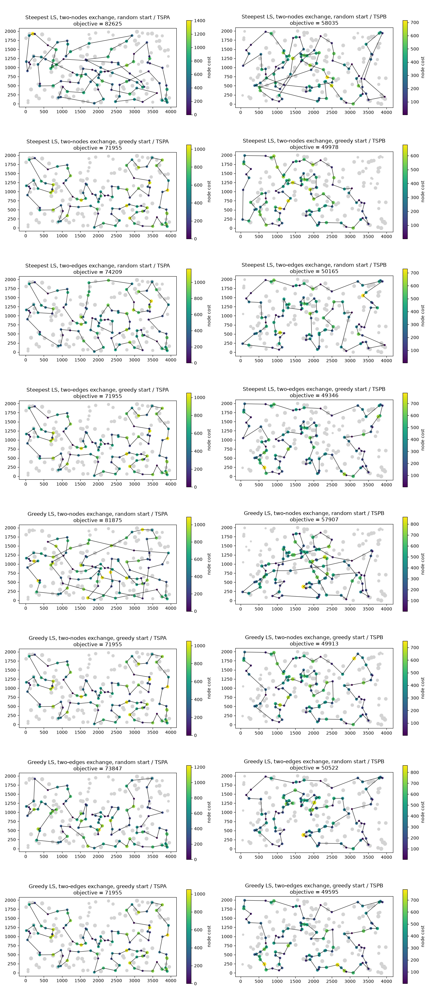

# Assignment 3: Local search

Team:

- Adam Mazur 160297
- Jakub Jęsiek 160312

## Problem description

We are given three columns of integers with a row for each node. The first two columns contain x and y coordinates of the node positions in a plane. The third column contains node costs. The goal is to select exactly 50% of the nodes (if the number of nodes is odd we round the number of nodes to be selected up) and form a Hamiltonian cycle (closed path) through this set of nodes such that the sum of the total length of the path plus the total cost of the selected nodes is minimized.

## Implemented algorithms

### Solution representation and moves

A solution is kept as two arrays: `sol` - the selected nodes in the order of the cycle, and `unsel` - the nodes that are not selected. The neighborhood is made of two kinds of moves:

- Inter-route move - exchange of a selected node `u = sol[i]` with a not selected node `v = unsel[k]`. `v` takes the place of `u` in the cycle. There are 100 * 100 = 10000 such moves.
- Intra-route move, one of two options:
  - two-nodes exchange - the nodes at positions `i` and `j` of the cycle swap places (100 * 99 / 2 = 4950 moves),
  - two-edges exchange - edges `(sol[i], sol[i+1])` and `(sol[j], sol[j+1])` are replaced with `(sol[i], sol[j])` and `(sol[i+1], sol[j+1])`, which means reversing `sol[i+1..j]` (100 * 97 / 2 = 4850 moves, pairs of edges with a common node are skipped because they do not change the solution).

The local search uses only the deltas of the objective function. The neighbor solution is never built. Only the edges that are removed and added (and the node costs for inter-route moves) are used:

```
inter (u -> v), p and n are the neighbours of u:
    delta = d(p, v) + d(v, n) - d(p, u) - d(u, n) + cost(v) - cost(u)

two-nodes exchange of a and b:
    not neighbours: delta = d(pa, b) + d(b, na) + d(pb, a) + d(a, nb)
                          - d(pa, a) - d(a, na) - d(pb, b) - d(b, nb)
    neighbours p - a - b - n: delta = d(p, b) + d(a, n) - d(p, a) - d(b, n)

two-edges exchange of (a1, a2) and (b1, b2):
    delta = d(a1, b1) + d(a2, b2) - d(a1, a2) - d(b1, b2)
```

(`pa`, `na` are the previous and the next node of `a`, the same for `b`. Neighbours also include the last and the first node of the cycle.) In intra-route moves the set of nodes does not change, so the node costs cancel out.

### Steepest local search

In each iteration all moves of both kinds are evaluated and the best one is performed.

```
SteepestLS(sol, unsel):
    repeat
        best_delta = 0, best_move = none
        for each inter-route move m:
            if delta(m) < best_delta: best_delta, best_move = delta(m), m
        for each intra-route move m:
            if delta(m) < best_delta: best_delta, best_move = delta(m), m
        if best_move is none:
            return sol
        apply best_move to sol, unsel
```

### Greedy local search

The first improving move found is performed. The moves are browsed in a random order.

```
GreedyLS(sol, unsel):
    moves = list of all inter-route and intra-route moves
    repeat
        found = false
        for t = 0 .. |moves| - 1:
            r = random integer from t .. |moves| - 1
            swap moves[t] and moves[r]
            if delta(moves[t]) < 0:
                apply moves[t] to sol, unsel
                found = true
                break
    until not found
    return sol
```

Randomization: both kinds of moves (inter-route and intra-route) are in one list and the list is browsed in a uniformly random order. The order is generated lazily with the Fisher-Yates shuffle - in step `t` we draw one of the moves that were not used yet in this pass, so we only draw the moves that we actually evaluate (the deltas of the other moves are never calculated). After each performed move a new random order is drawn. The search stops when all moves were evaluated and none of them improves the solution.

### Starting solutions

- Random - the same 200 random solutions as in the "Random" row of the tables.
- Greedy - the best construction heuristic from the previous assignments (the lowest mean objective) started from each of the 200 nodes. On TSPA it is weighted 2-regret based on greedy cycle, on TSPB weighted 2-regret based on NN (any position). We choose it separately for each instance, because a different heuristic is the best on each of them (summed over both instances the two weighted versions differ by only about 0.1%).

## Results

Each method was run 200 times on each instance. Greedy construction heuristics and local search with greedy starting solutions were started once from every node. The tables show `average (min – max)`.

All methods (also the ones from the previous assignments) were implemented with numba, compiled before the measurements and timed in the same way, so the running times can be compared. The construction heuristics give the same solutions as in the previous assignments. The running time of the local search includes building the starting solution - for the greedy start that is about 0.9-1.0 ms (see the rows of the construction heuristics). Times were measured on an Intel Core i5-13450HX.

### Objective function

| Method | TSPA | TSPB |
|---|---|---|
| Random | 262874.39 (238989 – 290456) | 206009.68 (185119 – 225987) |
| NN (end only) | 87476.63 (84362 – 90075) | 59397.34 (56007 – 63166) |
| NN (any position) | 74346.96 (72328 – 77022) | 59475.50 (52915 – 66164) |
| Greedy cycle | 73792.87 (72590 – 75345) | 59777.50 (55655 – 63736) |
| 2-regret (NN any position) | 121360.29 (110950 – 135771) | 73649.84 (68761 – 79756) |
| 2-regret (greedy cycle) | 120378.76 (112806 – 128089) | 72484.84 (68150 – 77274) |
| Weighted 2-regret (NN any position) | 75549.36 (72419 – 78504) | 55698.94 (50485 – 61406) |
| Weighted 2-regret (greedy cycle) | 73349.74 (72011 – 75532) | 57766.23 (52906 – 63326) |
| Steepest LS, two-nodes exchange, random start | 90055.08 (82625 – 101632) | 65763.93 (58035 – 72736) |
| Steepest LS, two-nodes exchange, greedy start | 73018.38 (71955 – 74861) | 54292.94 (49978 – 61265) |
| Steepest LS, two-edges exchange, random start | 76199.78 (74209 – 79975) | 52570.36 (50165 – 56169) |
| Steepest LS, two-edges exchange, greedy start | 73000.46 (71955 – 74861) | 53091.99 (49346 – 60354) |
| Greedy LS, two-nodes exchange, random start | 87822.45 (81875 – 96510) | 63957.56 (57907 – 70477) |
| Greedy LS, two-nodes exchange, greedy start | 73020.53 (71955 – 74861) | 54280.90 (49913 – 61265) |
| Greedy LS, two-edges exchange, random start | 76232.96 (73847 – 79046) | 52991.80 (50522 – 55816) |
| Greedy LS, two-edges exchange, greedy start | 72979.98 (71955 – 74861) | 53151.48 (49595 – 60357) |

### Running time (ms)

| Method | TSPA | TSPB |
|---|---|---|
| Random | 0.007 (0.005 – 0.050) | 0.007 (0.006 – 0.042) |
| NN (end only) | 0.016 (0.013 – 0.031) | 0.015 (0.013 – 0.024) |
| NN (any position) | 0.978 (0.954 – 1.098) | 0.982 (0.962 – 1.013) |
| Greedy cycle | 0.871 (0.854 – 0.990) | 0.872 (0.854 – 0.900) |
| 2-regret (NN any position) | 0.976 (0.959 – 1.024) | 0.997 (0.963 – 1.772) |
| 2-regret (greedy cycle) | 0.878 (0.852 – 1.003) | 0.882 (0.855 – 0.957) |
| Weighted 2-regret (NN any position) | 0.985 (0.962 – 1.018) | 0.992 (0.976 – 1.016) |
| Weighted 2-regret (greedy cycle) | 0.879 (0.852 – 0.905) | 0.877 (0.859 – 0.905) |
| Steepest LS, two-nodes exchange, random start | 21.345 (17.668 – 29.358) | 20.824 (16.516 – 26.492) |
| Steepest LS, two-nodes exchange, greedy start | 1.516 (1.043 – 2.295) | 2.620 (1.229 – 4.372) |
| Steepest LS, two-edges exchange, random start | 16.306 (13.748 – 18.494) | 16.312 (14.385 – 19.460) |
| Steepest LS, two-edges exchange, greedy start | 1.452 (1.028 – 2.269) | 2.879 (1.488 – 4.788) |
| Greedy LS, two-nodes exchange, random start | 3.659 (2.195 – 7.403) | 3.425 (1.718 – 6.984) |
| Greedy LS, two-nodes exchange, greedy start | 1.812 (1.306 – 2.841) | 2.407 (1.429 – 4.077) |
| Greedy LS, two-edges exchange, random start | 2.466 (1.551 – 4.586) | 2.392 (1.640 – 3.902) |
| Greedy LS, two-edges exchange, greedy start | 1.765 (1.293 – 2.956) | 2.619 (1.612 – 5.006) |

### Number of moves

Average number of performed moves and of evaluated moves (deltas calculated) in one run of the local search:

| Method | TSPA moves | TSPA evaluated | TSPB moves | TSPB evaluated |
|---|---|---|---|---|
| Steepest LS, two-nodes exchange, random start | 154.8 | 2328762 | 150.8 | 2269784 |
| Steepest LS, two-nodes exchange, greedy start | 3.3 | 64659 | 10.5 | 171327 |
| Steepest LS, two-edges exchange, random start | 133.0 | 1990568 | 132.8 | 1987450 |
| Steepest LS, two-edges exchange, greedy start | 3.3 | 63706 | 14.3 | 227205 |
| Greedy LS, two-nodes exchange, random start | 418.2 | 143928 | 415.9 | 134677 |
| Greedy LS, two-nodes exchange, greedy start | 4.3 | 33088 | 15.4 | 53172 |
| Greedy LS, two-edges exchange, random start | 417.9 | 96980 | 418.1 | 96878 |
| Greedy LS, two-edges exchange, greedy start | 4.5 | 33244 | 26.3 | 63418 |

## Visualization

The plots show the best solution for each local search method and instance. Gray dots are nodes that were not picked. Picked nodes are colored by their cost, and bigger dots mean higher cost. The plots for the construction heuristics are in the previous reports.



## Best solutions

### Steepest LS, two-nodes exchange, random start

TSPA (82625):

108, 60, 149, 63, 168, 116, 31, 7, 48, 80, 38, 100, 123, 160, 83, 90, 132, 33, 9, 54, 174, 106, 89, 42, 150, 131, 52, 16, 51, 143, 62, 186, 136, 112, 4, 76, 71, 157, 91, 49, 97, 127, 161, 30, 141, 87, 102, 35, 67, 144, 53, 140, 41, 84, 58, 138, 151, 107, 57, 182, 192, 158, 134, 72, 176, 93, 130, 88, 78, 193, 153, 170, 159, 47, 50, 3, 169, 1, 178, 164, 142, 8, 194, 36, 177, 179, 45, 98, 189, 187, 171, 2, 114, 181, 135, 73, 185, 28, 180, 152

TSPB (58035):

167, 181, 152, 67, 66, 11, 27, 122, 160, 172, 136, 133, 8, 46, 86, 184, 3, 151, 197, 36, 175, 134, 45, 157, 69, 117, 72, 89, 57, 185, 76, 162, 192, 54, 127, 80, 182, 14, 2, 110, 90, 10, 114, 105, 94, 81, 187, 196, 129, 153, 20, 74, 17, 171, 99, 31, 24, 34, 88, 179, 87, 82, 132, 29, 6, 140, 47, 21, 38, 154, 97, 155, 71, 60, 64, 189, 120, 96, 198, 121, 183, 30, 191, 130, 147, 116, 149, 28, 145, 65, 158, 177, 125, 170, 115, 40, 59, 85, 51, 73

### Steepest LS, two-nodes exchange, greedy start

TSPA (71955):

37, 47, 130, 159, 146, 170, 153, 193, 78, 88, 107, 64, 57, 182, 138, 151, 42, 89, 113, 106, 150, 176, 72, 134, 84, 58, 158, 192, 181, 114, 135, 73, 45, 87, 141, 189, 2, 171, 187, 30, 161, 127, 97, 168, 63, 149, 116, 60, 49, 160, 83, 123, 100, 152, 108, 31, 48, 80, 91, 157, 71, 4, 76, 132, 180, 28, 102, 185, 35, 51, 16, 67, 144, 140, 53, 179, 52, 177, 36, 131, 33, 9, 54, 8, 174, 85, 93, 50, 3, 169, 1, 164, 186, 136, 184, 178, 29, 55, 101, 147

TSPB (49978):

65, 145, 28, 149, 13, 146, 37, 116, 147, 42, 50, 191, 130, 121, 198, 96, 48, 156, 89, 57, 185, 76, 162, 54, 192, 80, 127, 129, 90, 153, 14, 2, 20, 74, 17, 171, 99, 88, 179, 87, 82, 51, 85, 59, 73, 167, 181, 152, 34, 24, 67, 66, 27, 98, 151, 122, 3, 184, 46, 72, 117, 8, 120, 133, 136, 172, 160, 69, 189, 21, 183, 30, 38, 154, 140, 47, 64, 33, 40, 141, 155, 71, 60, 157, 45, 134, 175, 62, 36, 197, 6, 115, 170, 125, 177, 178, 29, 132, 174, 1

### Steepest LS, two-edges exchange, random start

TSPA (74209):

187, 30, 141, 87, 98, 114, 181, 135, 73, 45, 67, 144, 53, 140, 84, 131, 36, 177, 179, 52, 143, 33, 9, 54, 194, 8, 174, 176, 72, 134, 58, 192, 158, 138, 182, 57, 151, 150, 106, 42, 89, 107, 88, 78, 193, 153, 170, 159, 130, 93, 47, 147, 101, 29, 178, 184, 59, 1, 169, 50, 3, 85, 142, 164, 186, 136, 39, 115, 112, 139, 51, 16, 35, 156, 185, 102, 28, 180, 132, 76, 71, 157, 91, 80, 48, 31, 108, 152, 100, 123, 49, 60, 116, 149, 63, 168, 97, 127, 171, 2

TSPB (50165):

184, 3, 46, 72, 117, 8, 120, 133, 136, 172, 160, 69, 21, 183, 30, 130, 38, 47, 140, 154, 97, 155, 71, 141, 40, 60, 157, 45, 134, 175, 174, 1, 132, 29, 6, 115, 170, 125, 177, 158, 145, 28, 149, 116, 147, 42, 121, 198, 96, 48, 156, 89, 57, 190, 70, 81, 94, 105, 187, 18, 196, 114, 148, 10, 90, 129, 127, 80, 182, 153, 110, 2, 14, 20, 74, 171, 99, 192, 54, 162, 104, 185, 76, 27, 66, 67, 24, 34, 152, 181, 179, 87, 82, 51, 85, 59, 73, 167, 151, 122

### Steepest LS, two-edges exchange, greedy start

TSPA (71955):

37, 47, 130, 159, 146, 170, 153, 193, 78, 88, 107, 64, 57, 182, 138, 151, 42, 89, 113, 106, 150, 176, 72, 134, 84, 58, 158, 192, 181, 114, 135, 73, 45, 87, 141, 189, 2, 171, 187, 30, 161, 127, 97, 168, 63, 149, 116, 60, 49, 160, 83, 123, 100, 152, 108, 31, 48, 80, 91, 157, 71, 4, 76, 132, 180, 28, 102, 185, 35, 51, 16, 67, 144, 140, 53, 179, 52, 177, 36, 131, 33, 9, 54, 8, 174, 85, 93, 50, 3, 169, 1, 164, 186, 136, 184, 178, 29, 55, 101, 147

TSPB (49346):

65, 145, 28, 149, 13, 146, 37, 116, 147, 42, 121, 198, 96, 48, 89, 57, 190, 70, 187, 81, 94, 105, 61, 139, 196, 114, 10, 78, 54, 162, 192, 80, 127, 129, 90, 153, 14, 2, 20, 74, 17, 171, 39, 99, 67, 24, 34, 181, 179, 87, 82, 167, 51, 85, 59, 73, 98, 151, 122, 3, 184, 46, 72, 117, 8, 120, 133, 136, 172, 160, 69, 21, 38, 154, 140, 47, 64, 33, 40, 155, 71, 60, 157, 45, 134, 175, 62, 91, 36, 197, 132, 29, 6, 180, 115, 170, 177, 125, 26, 158

### Greedy LS, two-nodes exchange, random start

TSPA (81875):

1, 50, 3, 85, 8, 174, 130, 159, 153, 78, 88, 107, 192, 98, 187, 30, 160, 83, 123, 132, 76, 71, 157, 91, 80, 38, 180, 28, 185, 52, 177, 36, 131, 72, 150, 106, 42, 151, 176, 54, 9, 33, 99, 84, 58, 181, 114, 25, 135, 73, 140, 53, 41, 134, 158, 182, 57, 89, 113, 93, 47, 147, 164, 112, 139, 4, 100, 152, 108, 60, 116, 149, 63, 11, 49, 168, 95, 97, 127, 69, 171, 2, 189, 141, 87, 45, 179, 144, 67, 35, 156, 51, 16, 62, 186, 136, 163, 29, 101, 178

TSPB (57907):

152, 34, 24, 11, 135, 75, 3, 184, 173, 151, 98, 25, 88, 99, 171, 150, 80, 192, 162, 27, 64, 97, 115, 6, 29, 132, 1, 174, 36, 197, 180, 170, 177, 125, 26, 154, 69, 160, 117, 46, 79, 57, 89, 156, 72, 86, 76, 54, 196, 114, 10, 90, 14, 2, 74, 20, 153, 52, 129, 127, 66, 67, 122, 8, 63, 121, 198, 96, 120, 133, 136, 172, 168, 189, 21, 183, 30, 130, 191, 38, 47, 140, 155, 71, 40, 60, 157, 175, 134, 45, 82, 87, 179, 51, 85, 107, 59, 73, 167, 181

### Greedy LS, two-nodes exchange, greedy start

TSPA (71955):

37, 47, 130, 159, 146, 170, 153, 193, 78, 88, 107, 64, 57, 182, 138, 151, 42, 89, 113, 106, 150, 176, 72, 134, 84, 58, 158, 192, 181, 114, 135, 73, 45, 87, 141, 189, 2, 171, 187, 30, 161, 127, 97, 168, 63, 149, 116, 60, 49, 160, 83, 123, 100, 152, 108, 31, 48, 80, 91, 157, 71, 4, 76, 132, 180, 28, 102, 185, 35, 51, 16, 67, 144, 140, 53, 179, 52, 177, 36, 131, 33, 9, 54, 8, 174, 85, 93, 50, 3, 169, 1, 164, 186, 136, 184, 178, 29, 55, 101, 147

TSPB (49913):

125, 145, 28, 149, 13, 146, 37, 116, 147, 42, 50, 191, 130, 121, 198, 96, 48, 156, 89, 57, 104, 194, 190, 70, 187, 196, 114, 10, 78, 54, 162, 192, 80, 127, 129, 90, 153, 14, 2, 20, 74, 17, 171, 99, 88, 179, 87, 82, 51, 85, 59, 73, 167, 181, 152, 34, 24, 67, 66, 76, 135, 27, 98, 151, 122, 3, 184, 46, 72, 117, 8, 120, 133, 136, 172, 160, 69, 189, 21, 183, 30, 38, 154, 140, 47, 64, 33, 40, 141, 155, 71, 60, 157, 45, 134, 175, 132, 29, 6, 170

### Greedy LS, two-edges exchange, random start

TSPA (73847):

174, 176, 134, 58, 84, 99, 131, 54, 9, 33, 36, 177, 52, 67, 144, 179, 53, 140, 41, 61, 135, 73, 45, 87, 102, 185, 16, 51, 35, 156, 28, 180, 132, 76, 4, 71, 157, 91, 80, 48, 60, 116, 149, 63, 168, 11, 49, 108, 152, 123, 90, 83, 160, 97, 95, 127, 69, 171, 2, 189, 187, 30, 141, 98, 25, 114, 181, 192, 158, 111, 138, 182, 57, 64, 88, 78, 193, 153, 170, 146, 159, 130, 107, 89, 42, 151, 150, 106, 93, 47, 50, 3, 1, 178, 29, 136, 186, 164, 142, 8

TSPB (50522):

81, 187, 196, 114, 10, 54, 80, 127, 129, 90, 153, 14, 2, 20, 74, 17, 171, 99, 179, 87, 82, 51, 85, 107, 59, 73, 167, 181, 152, 34, 24, 67, 66, 192, 162, 104, 185, 76, 135, 3, 184, 173, 151, 122, 137, 46, 86, 72, 117, 8, 160, 69, 172, 136, 133, 120, 63, 130, 191, 30, 176, 183, 189, 21, 38, 47, 140, 154, 97, 155, 71, 40, 60, 45, 134, 175, 197, 132, 29, 6, 115, 170, 125, 177, 158, 145, 28, 149, 116, 147, 121, 198, 96, 48, 89, 57, 190, 70, 94, 105

### Greedy LS, two-edges exchange, greedy start

TSPA (71955):

37, 47, 130, 159, 146, 170, 153, 193, 78, 88, 107, 64, 57, 182, 138, 151, 42, 89, 113, 106, 150, 176, 72, 134, 84, 58, 158, 192, 181, 114, 135, 73, 45, 87, 141, 189, 2, 171, 187, 30, 161, 127, 97, 168, 63, 149, 116, 60, 49, 160, 83, 123, 100, 152, 108, 31, 48, 80, 91, 157, 71, 4, 76, 132, 180, 28, 102, 185, 35, 51, 16, 67, 144, 140, 53, 179, 52, 177, 36, 131, 33, 9, 54, 8, 174, 85, 93, 50, 3, 169, 1, 164, 186, 136, 184, 178, 29, 55, 101, 147

TSPB (49595):

105, 94, 70, 190, 57, 89, 72, 120, 96, 198, 121, 42, 147, 116, 37, 146, 13, 149, 28, 145, 158, 125, 170, 115, 180, 6, 29, 132, 197, 36, 91, 62, 175, 134, 45, 157, 60, 71, 155, 40, 33, 64, 97, 154, 140, 47, 38, 21, 69, 160, 172, 136, 133, 8, 117, 184, 3, 151, 27, 135, 76, 66, 67, 24, 34, 152, 181, 167, 73, 59, 85, 51, 82, 87, 179, 88, 163, 99, 39, 171, 17, 74, 20, 2, 14, 153, 90, 129, 127, 80, 192, 162, 54, 78, 10, 148, 114, 196, 187, 81

## Solution checker

All best solutions were checked: each has 100 distinct nodes and its objective value was recomputed from scratch, independently of the code of the heuristics. For every run of the local search the starting objective plus the sum of the deltas of the performed moves is equal to the final objective computed from scratch. The best local search solutions were also checked to be real local optima: every neighbor solution (all pairs of positions, all not selected nodes) was built explicitly and its objective computed from scratch, without the delta functions and the move lists of the local search (cell "Solution check" in the notebook). All best solutions were also checked with the provided solution checker (Solution checker.xlsx) and the objective values match.

## Source code

https://github.com/Adam-Mazur/evolutionary-computation-2026

## Conclusions

- Two-edges exchange is much better than two-nodes exchange when we start from random solutions (TSPA: about 76.2k vs 88-90k, TSPB: about 52.6-53.0k vs 64-66k). Two-edges exchange reverses a part of the cycle, so it can remove crossing edges. Two-nodes exchange changes four edges at once and it is hard to find an improving swap in a tangled cycle - the local optima still have many crossing edges (see the plots). With two-nodes exchange the local search from a random start is not even better than the simple NN (end only) heuristic.
- Starting from the greedy solutions gives the best single solutions on both instances (TSPA 71955, TSPB 49346). The greedy solutions are already good, so the local search makes only a few moves (3-26 on average) and improves the mean only a little (TSPA from 73350 to about 73000, TSPB from 55699 to 53092-54293). On TSPA all four local search variants with greedy start have the same min and max and almost the same mean (72980-73021).
- On TSPB the local search with two-edges exchange from random solutions has a better mean (52570 for steepest) than any variant with the greedy start, but its best solution is worse. Random starts give more diverse local optima, the greedy start always leads to a similar region.
- Steepest and greedy local search give very similar quality. From random starts, greedy is a bit better with two-nodes exchange and steepest is a bit better with two-edges exchange.
- Greedy local search is much faster from random starts: about 2.4-3.7 ms vs 16-21 ms for steepest. It evaluates 16-21 times fewer moves (about 0.1M vs 2M), but it makes about 3 times more moves (about 418 vs 133-155), because it takes the first improving move, which is usually smaller than the best one.
- From greedy starts the local search adds only about 0.5-2 ms to the construction (about 1 ms). Here greedy local search is not clearly faster than steepest (slower on TSPA, slightly faster on TSPB) - close to a local optimum most moves are not improving, so greedy has to browse a large part of the neighborhood anyway, and drawing moves in random order has its own cost.
- Local search is much more expensive than the construction heuristics (from random starts about 2.5-25 times slower than one construction), but with a good start it improves the best solutions found so far on both instances.
