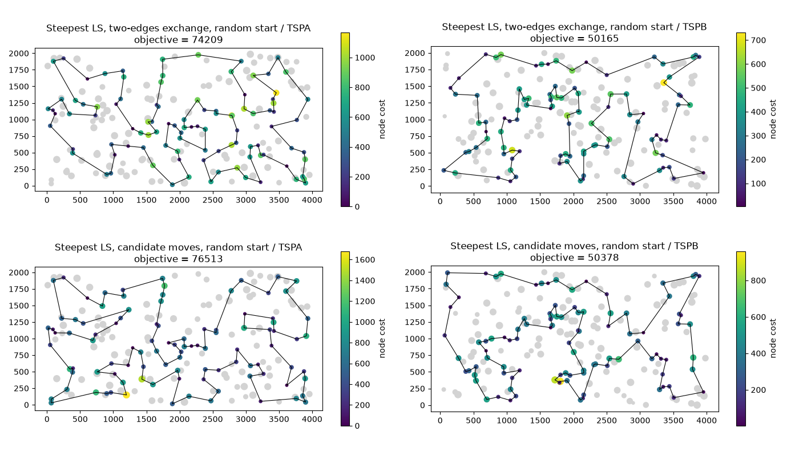

# Assignment 4: The use of candidate moves in local search

Team:

- Adam Mazur 160297
- Jakub Jęsiek 160312

## Problem description

We are given three columns of integers with a row for each node. The first two columns contain x and y coordinates of the node positions in a plane. The third column contains node costs. The goal is to select exactly 50% of the nodes (if the number of nodes is odd we round the number of nodes to be selected up) and form a Hamiltonian cycle (closed path) through this set of nodes such that the sum of the total length of the path plus the total cost of the selected nodes is minimized.

## Implemented algorithms

### Solution representation and moves

We use the neighborhood that was the best in the previous assignment: inter-route moves and two-edges exchange. A solution is kept as two arrays: `sol` - the selected nodes in the order of the cycle, and `unsel` - the nodes that are not selected. The neighborhood is made of two kinds of moves:

- Inter-route move - exchange of a selected node `u = sol[i]` with a not selected node `v = unsel[k]`. `v` takes the place of `u` in the cycle. There are 100 * 100 = 10000 such moves.
- Intra-route move - two-edges exchange - edges `(sol[i], sol[i+1])` and `(sol[j], sol[j+1])` are replaced with `(sol[i], sol[j])` and `(sol[i+1], sol[j+1])`, which means reversing `sol[i+1..j]` (100 * 97 / 2 = 4850 moves, pairs of edges with a common node are skipped because they do not change the solution).

The local search uses only the deltas of the objective function. The neighbor solution is never built. Only the edges that are removed and added (and the node costs for inter-route moves) are used:

```
inter (u -> v), p and n are the neighbours of u:
    delta = d(p, v) + d(v, n) - d(p, u) - d(u, n) + cost(v) - cost(u)

two-edges exchange of (a1, a2) and (b1, b2):
    delta = d(a1, b1) + d(a2, b2) - d(a1, a2) - d(b1, b2)
```

### Steepest local search (baseline)

The same as in the previous assignment. In each iteration all moves of both kinds are evaluated and the best one is performed.

```
SteepestLS(sol, unsel):
    repeat
        best_delta = 0, best_move = none
        for each inter-route move m:
            if delta(m) < best_delta: best_delta, best_move = delta(m), m
        for each two-edges exchange m:
            if delta(m) < best_delta: best_delta, best_move = delta(m), m
        if best_move is none:
            return sol
        apply best_move to sol, unsel
```

### Steepest local search with candidate moves

For each node `a` we determine its 10 "nearest" nodes `near[a]` - the nodes `b` with the smallest `d(a, b) + cost(b)`. An edge `(a, b)` with a selected node `a` and `b` in `near[a]` is a candidate edge. A candidate move is a move that adds at least one candidate edge to the solution. For each candidate edge there are two such moves:

- `b` is selected - two-edges exchange. We remove the edges after `a` and after `b`, i.e. `(a, next(a))` and `(b, next(b))`, or the edges before `a` and before `b`, i.e. `(prev(a), a)` and `(prev(b), b)`. In both cases `(a, b)` is one of the two added edges.
- `b` is not selected - inter-route move. `b` replaces the next node of `a` (added edges `(a, b)` and `(b, next(next(a)))`) or the previous node of `a` (added edges `(prev(prev(a)), b)` and `(b, a)`). Note that replacing `a` itself with `b` would not add the edge `(a, b)`, so it is not a candidate move.

We do not iterate over all moves. The first loop goes over the selected nodes `a` and the second over `near[a]`, so only the candidate moves are evaluated (about 100 * 10 * 2 = 2000 instead of 14850 in each iteration). To check in O(1) if `b` is selected and where it is, we keep the array `pos` (the position of each node in `sol` or in `unsel`) and update it after each performed move. The deltas are calculated in the same way as in the baseline.

```
SteepestLSCandidates(sol, unsel, near):
    repeat
        best_delta = 0, best_move = none
        for each position i of sol:
            a = sol[i]
            for each b in near[a]:
                if b is selected:
                    m1 = two-edges exchange removing (a, next(a)) and (b, next(b))
                    m2 = two-edges exchange removing (prev(a), a) and (prev(b), b)
                else:
                    m1 = inter-route move, b replaces next(a)
                    m2 = inter-route move, b replaces prev(a)
                for m in m1, m2:
                    if delta(m) < best_delta: best_delta, best_move = delta(m), m
        if best_move is none:
            return sol
        apply best_move to sol, unsel, pos
```

The same move can be evaluated twice (e.g. a two-edges exchange that adds two candidate edges), it does not change the result. The nearest nodes depend only on the instance (like the distance matrix), so they are determined once for each instance, before the runs.

### Starting solutions

- Random - the same 200 random solutions as in the "Random" row of the tables (the same as in the previous assignment). Both local search methods start from the same solutions.

## Results

Each method was run 200 times on each instance. Greedy construction heuristics were started once from every node. The tables show `average (min – max)`.

All methods (also the ones from the previous assignments) were implemented with numba, compiled before the measurements and timed in the same way, so the running times can be compared. The construction heuristics and the baseline local search give the same solutions as in the previous assignments. The running time of the local search includes building the starting solution. Determining the nearest nodes takes about 1.7 ms on TSPA and 1.2 ms on TSPB (once for each instance) and it is not included. Times were measured on an AMD Ryzen 7 5700U, which is a different (slower) computer than in the previous assignment, so all methods were measured again and the times should not be compared with the previous report.

### Objective function

| Method | TSPA | TSPB |
|---|---|---|
| Random | 262874.39 (238989 – 290456) | 206009.68 (185119 – 225987) |
| NN (end only) | 87476.63 (84362 – 90075) | 59397.34 (56007 – 63166) |
| NN (any position) | 74346.96 (72328 – 77022) | 59475.50 (52915 – 66164) |
| Greedy cycle | 73792.87 (72590 – 75345) | 59777.50 (55655 – 63736) |
| 2-regret (NN any position) | 121360.29 (110950 – 135771) | 73649.84 (68761 – 79756) |
| 2-regret (greedy cycle) | 120378.76 (112806 – 128089) | 72484.84 (68150 – 77274) |
| Weighted 2-regret (NN any position) | 75549.36 (72419 – 78504) | 55698.94 (50485 – 61406) |
| Weighted 2-regret (greedy cycle) | 73349.74 (72011 – 75532) | 57766.23 (52906 – 63326) |
| Steepest LS, two-edges exchange, random start | 76199.78 (74209 – 79975) | 52570.36 (50165 – 56169) |
| Steepest LS, candidate moves, random start | 80148.18 (76513 – 85021) | 52669.16 (50378 – 55491) |

### Running time (ms)

| Method | TSPA | TSPB |
|---|---|---|
| Random | 0.036 (0.013 – 0.167) | 0.016 (0.013 – 0.058) |
| NN (end only) | 0.035 (0.029 – 0.128) | 0.037 (0.029 – 0.180) |
| NN (any position) | 2.426 (2.107 – 4.328) | 2.324 (2.070 – 3.407) |
| Greedy cycle | 2.282 (1.969 – 4.948) | 2.226 (1.931 – 4.277) |
| 2-regret (NN any position) | 2.493 (2.128 – 4.445) | 2.623 (2.071 – 12.542) |
| 2-regret (greedy cycle) | 2.232 (1.976 – 3.669) | 2.117 (1.925 – 3.503) |
| Weighted 2-regret (NN any position) | 2.414 (2.103 – 5.223) | 3.012 (2.064 – 13.440) |
| Weighted 2-regret (greedy cycle) | 2.267 (1.971 – 5.019) | 2.525 (1.943 – 8.383) |
| Steepest LS, two-edges exchange, random start | 9.074 (7.239 – 14.867) | 8.518 (7.060 – 13.264) |
| Steepest LS, candidate moves, random start | 3.028 (2.389 – 5.459) | 3.044 (2.274 – 5.371) |

### Number of moves

Average number of performed moves and of evaluated moves (deltas calculated) in one run of the local search:

| Method | TSPA moves | TSPA evaluated | TSPB moves | TSPB evaluated |
|---|---|---|---|---|
| Steepest LS, two-edges exchange, random start | 133.0 | 1990568 | 132.8 | 1987450 |
| Steepest LS, candidate moves, random start | 124.9 | 226703 | 131.3 | 233449 |

## Visualization

The plots show the best solution for each local search method and instance. Gray dots are nodes that were not picked. Picked nodes are colored by their cost, and bigger dots mean higher cost. The plots for the construction heuristics are in the previous reports.



## Best solutions

### Steepest LS, two-edges exchange, random start

TSPA (74209):

187, 30, 141, 87, 98, 114, 181, 135, 73, 45, 67, 144, 53, 140, 84, 131, 36, 177, 179, 52, 143, 33, 9, 54, 194, 8, 174, 176, 72, 134, 58, 192, 158, 138, 182, 57, 151, 150, 106, 42, 89, 107, 88, 78, 193, 153, 170, 159, 130, 93, 47, 147, 101, 29, 178, 184, 59, 1, 169, 50, 3, 85, 142, 164, 186, 136, 39, 115, 112, 139, 51, 16, 35, 156, 185, 102, 28, 180, 132, 76, 71, 157, 91, 80, 48, 31, 108, 152, 100, 123, 49, 60, 116, 149, 63, 168, 97, 127, 171, 2

TSPB (50165):

184, 3, 46, 72, 117, 8, 120, 133, 136, 172, 160, 69, 21, 183, 30, 130, 38, 47, 140, 154, 97, 155, 71, 141, 40, 60, 157, 45, 134, 175, 174, 1, 132, 29, 6, 115, 170, 125, 177, 158, 145, 28, 149, 116, 147, 42, 121, 198, 96, 48, 156, 89, 57, 190, 70, 81, 94, 105, 187, 18, 196, 114, 148, 10, 90, 129, 127, 80, 182, 153, 110, 2, 14, 20, 74, 171, 99, 192, 54, 162, 104, 185, 76, 27, 66, 67, 24, 34, 152, 181, 179, 87, 82, 51, 85, 59, 73, 167, 151, 122

### Steepest LS, candidate moves, random start

TSPA (76513):

157, 71, 91, 38, 80, 48, 31, 60, 108, 152, 4, 76, 132, 123, 160, 49, 63, 149, 116, 168, 95, 97, 127, 69, 129, 104, 92, 171, 2, 183, 189, 187, 161, 30, 141, 180, 28, 87, 96, 98, 73, 135, 114, 181, 192, 158, 58, 84, 134, 176, 174, 150, 106, 89, 151, 57, 88, 78, 153, 170, 159, 107, 130, 93, 3, 142, 164, 1, 169, 50, 47, 37, 147, 101, 55, 29, 178, 136, 186, 9, 54, 33, 131, 36, 177, 179, 52, 67, 144, 53, 140, 45, 185, 35, 16, 51, 139, 112, 5, 115

TSPB (50378):

73, 167, 181, 152, 98, 151, 3, 184, 86, 46, 72, 117, 8, 120, 133, 136, 172, 160, 69, 21, 30, 38, 47, 140, 154, 26, 125, 177, 170, 115, 155, 71, 40, 60, 157, 45, 134, 175, 62, 36, 197, 6, 29, 132, 178, 65, 28, 149, 146, 37, 116, 147, 42, 121, 198, 96, 48, 156, 89, 57, 185, 76, 104, 162, 54, 187, 70, 81, 94, 105, 196, 114, 10, 148, 56, 118, 110, 2, 14, 20, 74, 153, 90, 129, 127, 80, 192, 84, 66, 67, 24, 34, 179, 87, 82, 51, 101, 85, 107, 59

## Solution checker

All best solutions were checked.

## Source code

https://github.com/Adam-Mazur/evolutionary-computation-2026

## Conclusions

- Candidate moves make the local search about 3 times faster (TSPA: 3.0 ms vs 9.1 ms, TSPB: 3.0 ms vs 8.5 ms). In each iteration only about 1800 moves are evaluated instead of 14850, and the number of iterations is similar (125-131 vs 133), so in total about 8.5-8.8 times fewer moves are evaluated. The time drops less than the number of evaluated moves, because one candidate move is more expensive to find (lookups in `near` and `pos`, conditions), while the baseline goes through the moves in simple loops.
- On TSPB the quality is almost the same (mean 52669 vs 52570, +0.2%), the worst solution is even better (55491 vs 56169) and the best one is a bit worse (50378 vs 50165).
- On TSPA the quality is clearly worse (mean 80148 vs 76200, +5.2%, best 76513 vs 74209). Most of the difference comes from the node costs (on average 56596 vs 53068, the path length 23552 vs 23132). In a random solution there are many expensive nodes. An expensive node `u` can be removed only by an inter-route move in which the new node is one of the nearest nodes of a neighbour of `u`, so some expensive nodes stay in the solution (the most expensive selected node has on average cost 1853 vs 1353 in the baseline, see also the plots). On TSPA the node costs are up to about 2000, on TSPB only up to about 1000, so this matters more on TSPA.
- The local optima of the candidate moves are not local optima of the full neighborhood, because the moves that add only long edges are not evaluated. This is the price for the shorter running time.
- Determining the nearest nodes (1.2-1.7 ms) is done only once for each instance, so it does not matter when the local search is run many times.
